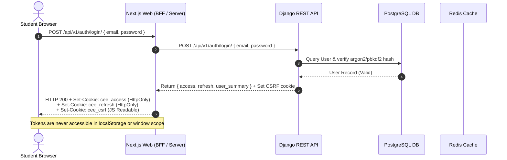
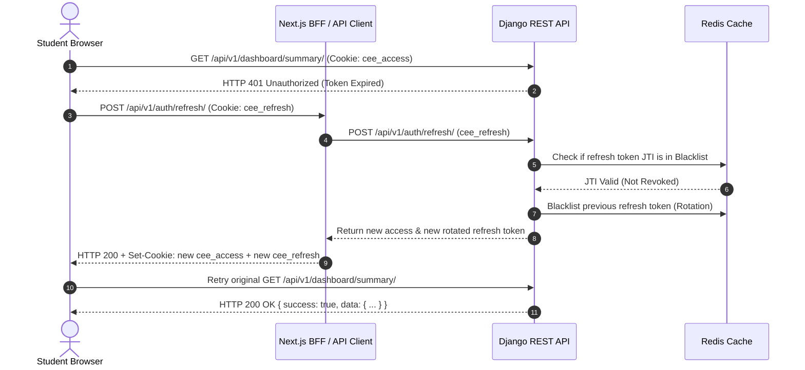
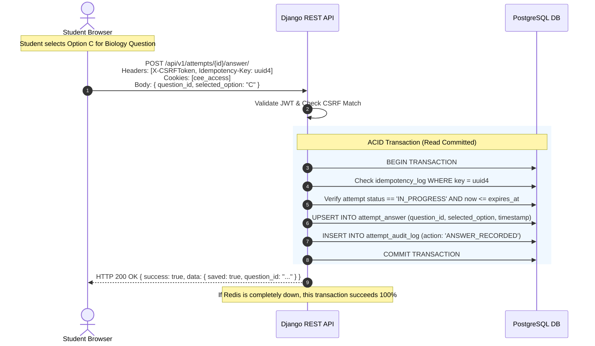

# ADR 003: HttpOnly Cookie Authentication Architecture & Request Flow

## Status

Accepted

## Context

In our medical entrance platform for Nepal CEE students, security and exam integrity are paramount. We must protect against:

1. **Cross-Site Scripting (XSS)**: If access tokens are stored in `localStorage` or accessible to browser JavaScript, any third-party script or injected content can exfiltrate tokens and compromise candidate accounts, exam answers, or faculty question authoring tools.
2. **Cross-Site Request Forgery (CSRF)**: If cookies are used without rigorous CSRF protections, unauthorized state mutations could be executed on behalf of authenticated students.
3. **Session Interruption in Low-Bandwidth Environments**: Regional students in Nepal frequently experience network latency and packet loss. Authentication must be resilient, supporting seamless silent refresh without forcing repetitive logins during 3-hour mock tests.

---

## Decision

### 1. Unified Same-Site Deployment Topology

We mandate a unified parent domain topology:

- **Web Frontend**: `https://nepalcee.com`
- **Backend API**: `https://api.nepalcee.com` (or reverse-proxied at `https://nepalcee.com/api/v1/`)
- **Cookie Scope**: `Domain=.nepalcee.com; SameSite=Lax; Secure`

### 2. Next.js BFF Evaluation & Dual-Tier Strategy

We evaluated two session management paradigms:

- **Pure Client-to-Django**: Browser calls `api.nepalcee.com` directly.
- **Next.js Backend-For-Frontend (BFF)**: Browser calls Next.js Route Handlers (`/api/auth/*`), which securely communicate with Django REST Framework server-to-server.

**Selected Architecture**: **Hybrid BFF with Direct API Optimization**

- **Auth Lifecycle Operations (Login, Register, Refresh, Logout)**: Mediated through **Next.js Route Handlers (BFF)**. Next.js acts as an auth broker and allowlisted proxy to Django. Django owns credential validation and cookie issuance; the BFF forwards `Set-Cookie` headers unchanged and never reads or serializes token values. Cookies remain `HttpOnly`, `Secure` in production, and `SameSite=Lax`.
- **Server Component Data Fetching (RSC)**: Next.js Server Components read the incoming cookie from the server request and forward it directly to Django REST Framework via internal fast networking (`http://api:8000/api/v1/...`).
- **Client Interactive Queries (Live Exam Runner, Flashcards)**: Client components call `/api/v1/...` directly using `credentials: 'include'` and passing the `X-CSRFToken` header.

### 3. Cookie Storage Specification

- `cee_access`: JWT Access token (15-min TTL, `HttpOnly`, `Secure`, `SameSite=Lax`, `Path=/`).
- `cee_refresh`: JWT Refresh token (7-day TTL, `HttpOnly`, `Secure`, `SameSite=Lax`, `Path=/api/v1/auth/`).
- `cee_csrf`: Anti-CSRF token (7-day TTL, `HttpOnly=False`, `Secure`, `SameSite=Lax`, `Path=/`).

---

## Detailed Request Flows

### 1. Authentication & Session Initialization Flow

### 2. Silent Token Refresh Flow

### 3. High-Stakes Exam Answer Submission Flow (Idempotency + Integrity)

---

## Remaining Implementation Risks & Mitigation Strategy (Before Phase 1)

1. **Risk: Cross-Origin Cookie Dropping in Multi-Domain Staging**  
   _Risk_: If staging frontend is on `vercel.app` and backend is on `fly.dev`, browsers will drop `SameSite=Lax` cookies.  
   _Mitigation_: Staging environment must use subdomain routing on the actual company domain (e.g., `staging.nepalcee.com` and `api-staging.nepalcee.com`).

2. **Risk: Next.js Server-Side Fetch Cookie Forwarding**  
   _Risk_: React Server Components do not automatically forward browser cookies to internal Django API calls unless explicitly passed via `headers: { Cookie: cookies().toString() }`.  
   _Mitigation_: Implement a dedicated `serverApiClient()` utility using `next/headers` that automatically propagates incoming cookies for all Server Component queries.

3. **Risk: Clock Skew between App Server and Redis/PostgreSQL**  
   _Risk_: If server clocks drift by even 60 seconds, JWT expiry checks or negative marking timestamps could fail.  
   _Mitigation_: Enforce NTP clock synchronization across all production container instances.

## Phase 3A Implementation Note

The Django authentication API exposes CSRF bootstrap, student registration, verified-user login, current-user, email verification, recovery/reset, refresh rotation, and logout/revocation under `/api/v1/auth/`. The same-origin Next.js proxy is limited to these paths and forwards the required cookies/CSRF headers without exposing token values. Direct browser API mutations continue using credentials and `X-CSRFToken`; JWTs remain HttpOnly cookies. User-facing auth pages remain separate work.
