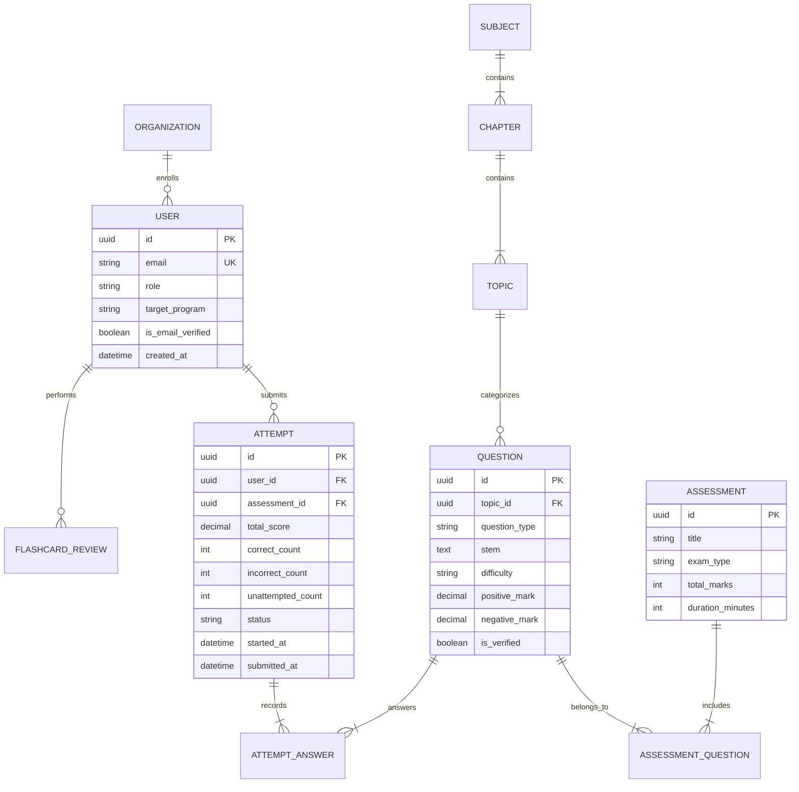

# Database Architecture & Design Foundations

## 1. Core Principles

- **Primary Keys**: UUIDv4 (`UUIDModel`) across all primary entities to eliminate sequential ID guessing attacks.
- **Auditability**: `TimeStampedModel` on all models (`created_at`, `updated_at` with database indexing).
- **Soft Deletion**: `SoftDeleteModel` on user-generated content, test attempts, and question records to prevent accidental cascading data loss.
- **Strict Foreign Keys**: `on_delete=models.PROTECT` on vital academic records (questions linked to past student attempts cannot be deleted).

## 2. Entity Relationship Overview

## 3. CEE Marking System Guarantees

In Nepal Medical CEE:

- Correct answer: `+1.00`
- Incorrect answer: `-0.25` (negative marking)
- Unattempted answer: `0.00`

Attempt scores are calculated using immutable `ATTEMPT_ANSWER` logs stored during the test session.
