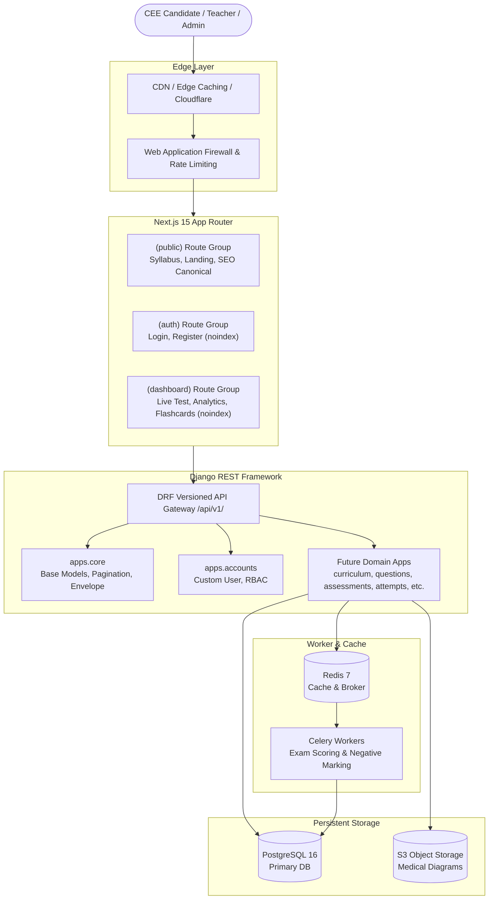

# Nepal Medical CEE Platform — Architecture & System Overview

## 1. Executive Summary

The **Nepal Medical CEE Preparation Platform** is an enterprise-grade digital learning, examination, and diagnostic tutoring system explicitly engineered for students, teachers, creators, and coaching institutions participating in the **Nepal Medical Education Commission Common Entrance Examination (CEE)**.

The platform targets candidate success in undergraduate medical entrance programs:

- **MBBS** (Bachelor of Medicine, Bachelor of Surgery)
- **BDS** (Bachelor of Dental Surgery)
- **B.Sc Nursing / BASLP**
- **B.Pharmacy / BAMS / BPT / B.Optometry**

## 2. Technology Stack Selection

| Layer                | Technology                                                         | Primary Rationale                                                                                                                    |
| :------------------- | :----------------------------------------------------------------- | :----------------------------------------------------------------------------------------------------------------------------------- |
| **Frontend**         | Next.js 15+ (App Router) + TypeScript                              | Server components for instant initial paint, optimal public SEO indexing, strictly separated route groups, accessible UI primitives. |
| **Backend API**      | Django 5.1+ / DRF 3.15+ (Python 3.12+)                             | Mature ORM with robust ACID transactional guarantees, built-in admin dashboard, declarative permissions, and secure auth models.     |
| **Primary Database** | PostgreSQL 16                                                      | Relational data integrity, native JSONB support for complex question formats, indexing for millions of attempt logs.                 |
| **Caching & Queues** | Redis 7 + Celery 5.4                                               | Asynchronous score calculation, email/SMS notifications, leaderboard calculation, rank distribution caching.                         |
| **Object Storage**   | S3-compatible (MinIO in local dev, AWS S3 / Cloudflare R2 in prod) | Medical diagrams, histology slides, past exam PDFs, audio mnemonics.                                                                 |
| **AI Integration**   | Provider-agnostic abstraction (Anthropic, OpenAI, Gemini)          | Decoupled client adapters allowing hot-swapping AI reasoning engines for Socratic tutoring without platform lock-in.                 |

## 3. High-Level Architecture Diagram

